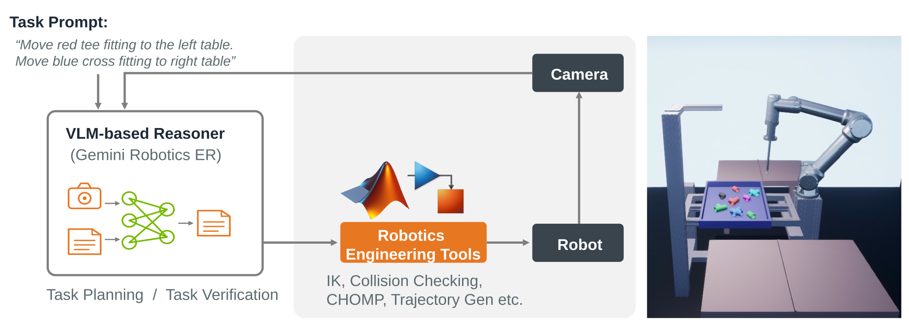
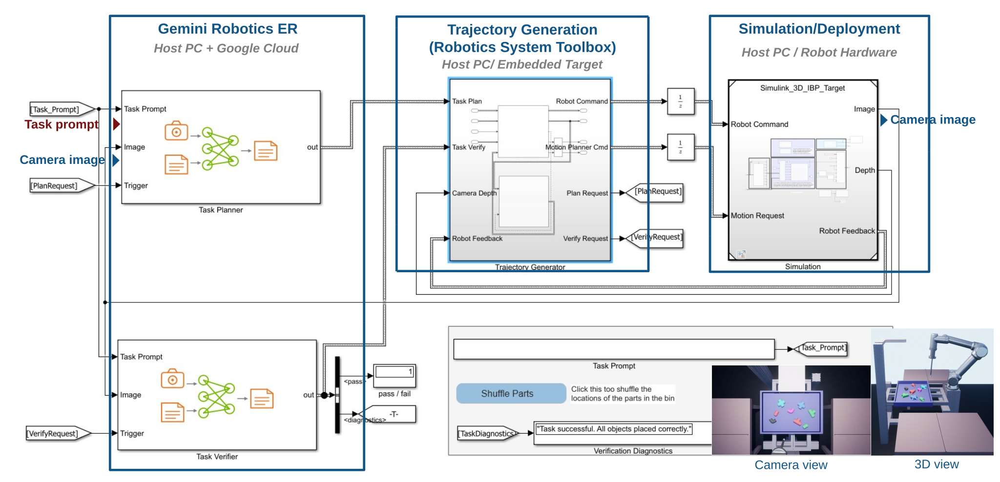
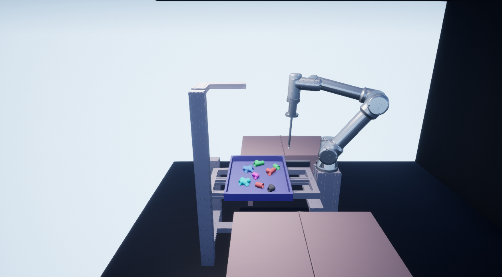
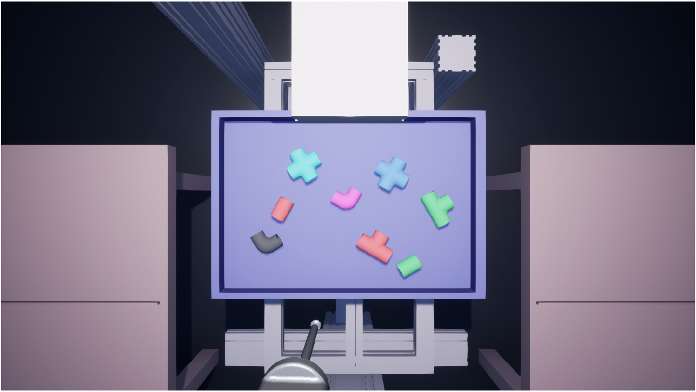
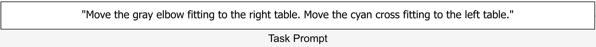
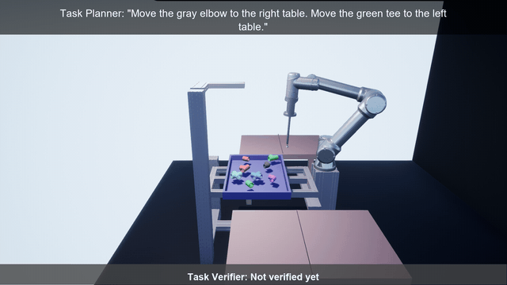
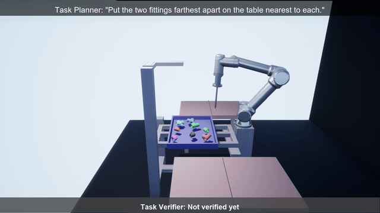
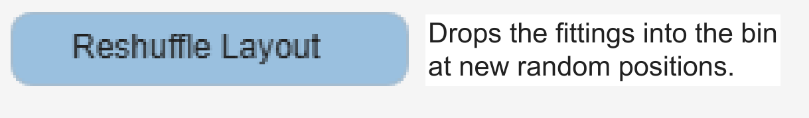
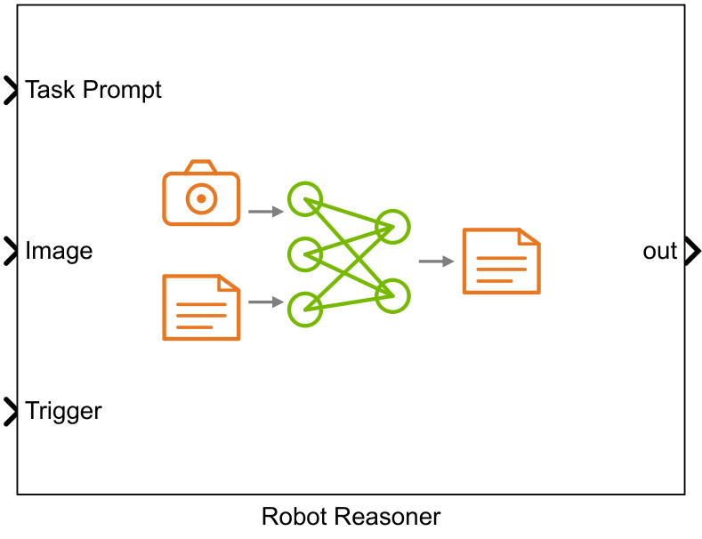
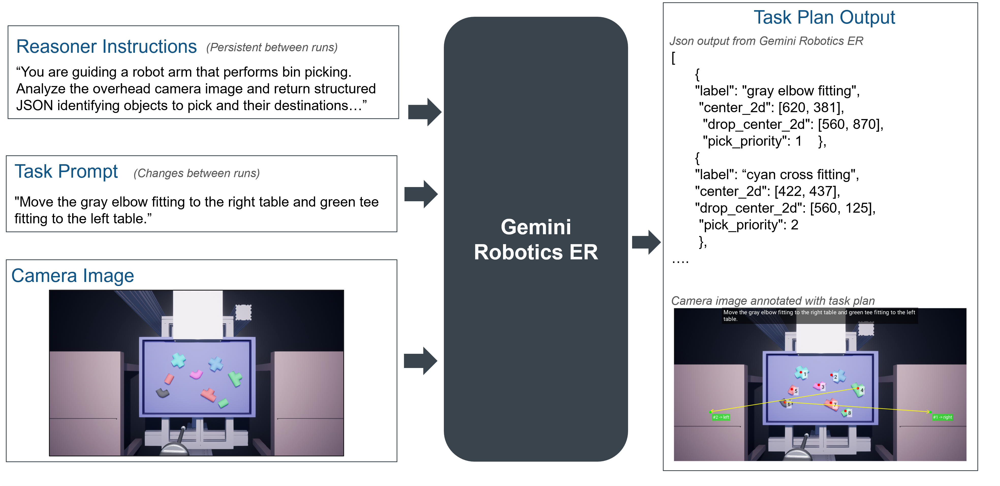

# Intelligent Bin Picking in Simulink using Gemini Robotics ER

[](https://www.mathworks.com/matlabcentral/fileexchange/184407-intelligent-bin-picking-in-simulink-using-gemini-robotics-er)
[](https://matlab.mathworks.com/open/fileexchange/v1?id=184407)

This project shows how to integrate Gemini Robotics ER into Simulink&reg; for intelligent robot bin picking, turning a natural-language task and an overhead camera image into a verified pick-and-place plan.



- [Overview](#overview)
- [Requirements](#requirements)
- [Setup](#setup)
- [Getting Started](#getting-started)
- [Calling Gemini from Simulink](#calling-gemini-from-simulink)
- [Limitations](#limitations)
- [Safety](#safety)
- [Conclusions](#conclusions)
- [References](#references)
- [License](#license)
- [Security](#security)
- [Feedback](#feedback)
- [Community Support](#community-support)

## Overview

[Gemini Robotics ER](https://ai.google.dev/gemini-api/docs/robotics-overview) is a vision-language model from Google with embodied reasoning (ER) capabilities: it understands a camera image in physical, spatial terms and turns a natural-language instruction into robot-actionable outputs such as object locations, pick sequences, and placement targets. This removes the need for a custom-trained object detector or hand-written pick rules.

This example adapts the [Intelligent Bin Picking System in Simulink](https://www.mathworks.com/help/robotics/ug/intelligent-bin-picking-system-in-simulink.html) example, in which a robot arm picks parts from a bin using an overhead camera. The original example uses a Mask R-CNN object detector and fixed pick rules; this project replaces both with Gemini Robotics ER, so you define a new task by writing a natural-language instruction instead of training a detector or hand-coding which parts to pick, in what order, and where to place them. The model is organized into three regions, shown left to right in the figure below: **Gemini Robotics ER**, **Trajectory Generation**, and **Simulation/Deployment**.



**Gemini Robotics ER.** Two blocks call Gemini. The **Task Planner** takes the camera image and your instruction (e.g. *"Place all elbow fittings on the right table"*) and returns which objects to pick, where to place each one, and in what order. After the robot finishes, the **Task Verifier** compares the before and after images and reports whether the task succeeded, with a short explanation (e.g. *"Task successful. All objects placed correctly."*). If it failed, the robot tries again.

**Trajectory Generation.** Gemini decides *what* to move and *where*, but not *how* the robot moves. The **Trajectory Generator** converts the planned pick and drop points from image pixels to 3D positions using the depth image, then plans a collision-free path for the arm with the CHOMP motion planner from the original example. Because motion planning stays classical, the robot always follows a safe, planned path, whatever the model returns.

**Simulation/Deployment.** The **Simulation** block renders the robot, bins, and parts in a 3D scene and provides the camera images that Gemini sees. Because the Gemini blocks only take images in and send plans out, you can replace this block with a real camera and robot without changing them.

## Requirements

### MathWorks Products

Requires MATLAB&reg; R2026a or newer.
- [Robotics System Toolbox&trade;](https://www.mathworks.com/products/robotics.html)
- [Simulink&reg;](https://www.mathworks.com/products/simulink.html)
- [Stateflow&reg;](https://www.mathworks.com/products/stateflow.html)
- [Simulink&reg; 3D Animation&trade;](https://www.mathworks.com/products/3d-animation.html)
- [Computer Vision Toolbox&trade;](https://www.mathworks.com/products/computer-vision.html)
- [Optimization Toolbox&trade;](https://www.mathworks.com/products/optimization.html)

For Windows&reg; you may need to install
- [MATLAB Support for MinGW&reg;-w64 C/C++/Fortran&reg; Compiler](https://www.mathworks.com/matlabcentral/fileexchange/52848-matlab-support-for-mingw-w64-c-c-fortran-compiler)

### 3rd Party Products

- [Python&reg;](https://www.python.org/) 3.13: MATLAB and Python cosimulation for Gemini API calls
- [google-genai](https://pypi.org/project/google-genai/): Gemini API client
- [Pillow](https://pypi.org/project/Pillow/): image encoding
- [numpy](https://numpy.org/): array interchange between MATLAB and Python
- Gemini access: [Google AI Studio API key](https://aistudio.google.com/apikey) ([Set Up Gemini Access](#set-up-gemini-access))

See the [Setup](#setup) section for how to install these.

## Setup

### Install the Python environment

Run once after cloning the project. In MATLAB, from the repo root, download the Python 3.13
environment and client packages, then verify the install:

```matlab
installPythonEnv
runtests("test/testPythonEnv.m")
```

`testPythonEnv` confirms that the bundled interpreter reports Python 3.13, that the client packages
(`google-genai`, `Pillow`, `numpy`) import, and that the project's `geminiClient` module loads.

### Install the Intelligent Bin Picking in Simulink example

Fetch the
[Intelligent Bin Picking in Simulink](https://www.mathworks.com/help/robotics/ug/intelligent-bin-picking-system-in-simulink.html)
example, then verify the install:

```matlab
installIntelligentBinPicking
runtests("test/testBinPickingExample.m")
```

`installIntelligentBinPicking` installs the example under
`dependencies/IntelligentBinPickingExample` and patches it to accept the Gemini pick order and
drop positions. `testBinPickingExample` confirms the required MathWorks products are installed,
the example files were fetched, and the models simulate without error.

### Set Up Gemini Access

Gemini Robotics ER is hosted by Google, so no server setup is required. Get an API key and free
trial credits from [Google AI Studio](https://aistudio.google.com/apikey), then set the key in your
MATLAB session:

```matlab
setenv("GEMINI_API_KEY", "your-key-here")
```

Run the test to check that Gemini is reachable with your API key:

```matlab
runtests("test/tGeminiClient.m")
```

The test sends a small image to Gemini Robotics ER and checks that it returns a JSON reply. It
should pass and print the model it reached, for example:

> Served model: gemini-robotics-er-2-preview

The test is skipped if `GEMINI_API_KEY` is not set.

## Getting Started

Run `projectstartup` at the beginning of each MATLAB session to configure paths, the Python environment, and the workspace parameters (set `GEMINI_API_KEY` again in each new session):

```matlab
projectstartup
```

### Scene Reference

This project uses a Universal Robots UR5e cobot with a Robotiq ePick suction gripper. The cobot picks the chosen PVC pipe fittings from the purple tray in the middle and places them on the left or right table. Gemini reads the task prompt and decides which fittings to pick, in what order, and which table each one goes to. It also chooses the drop point on that table: a free spot well inside the table, apart from the other placed fittings, unless the task asks for a specific placement.



The camera is mounted on the stand above the robot and looks straight down at the bin. Use its view as a reference when writing task prompts:



Each fitting has a color (red, green, blue, cyan, magenta, or gray) and a shape (elbow, cross, tee, or straight). A prompt can select fittings by color, shape, position in the bin (e.g., leftmost or top row), relation to another fitting (e.g., the fitting closest to the red elbow), or any combination of these.

### Running a Scenario

Open the model and simulate:

```matlab
modelName = "IntelligentBinPickingGemini";
open_system(modelName)
```

`IntelligentBinPickingGemini.slx` has a **Task Prompt** block that holds the natural-language task for the run:



To run a different task, double-click the **Task Prompt** block, replace its **String** parameter with your prompt, and run the simulation again. The **String** parameter is a MATLAB expression, so keep the prompt text in double quotes, for example:

```
"Move the gray elbow to the right table. Move the green tee to the left table."
```

### Prompts to Try

The **Expected result** column assumes the shipped layout shown in [Scene Reference](#scene-reference). The animations were recorded on a reshuffled layout (see [Randomizing Object Positions](#randomizing-object-positions)), so spatial prompts can select different fittings. Each animation shows its prompt on top and the Task Verifier result at the bottom.

**Color and shape reasoning**

| Prompt | Tests | Expected result |
|---|---|---|
| "Move the gray elbow to the right table. Move the green tee to the left table." | Color and shape | Gray elbow &rarr; right, green tee &rarr; left |
| "Move the crosses to the right table and the elbows to the left table." | Shape groups | Cyan and blue crosses &rarr; right, gray and magenta elbows &rarr; left |
| "Move every fitting that is not red or green to the left table." | Negation | Cyan cross, blue cross, magenta elbow, gray elbow &rarr; left |




**Spatial reasoning**

| Prompt | Tests | Expected result |
|---|---|---|
| "Move the fitting surrounded by all the others to the left table." | Center of the group | Magenta elbow &rarr; left |
| "Move the red fittings to the table closer to the gray elbow." | Distance from another object to each table | Red straight and red tee &rarr; left |
| "Put the two fittings farthest apart on the table nearest to each." | Pairwise distances, then nearest table | Gray elbow &rarr; left, green tee &rarr; right |




For more prompts, including color or shape filters combined with position and pick order, placement on a specific spot of a table, and ambiguous or edge-case tasks, see [Example Prompts](docs/ExamplePrompts.md).

### Randomizing Object Positions

Each simulation starts with the fixed layout from the original example. To test robustness across different arrangements, click the **Reshuffle Layout** button in `IntelligentBinPickingGemini.slx`:



The parts are dropped at random positions over the tray floor, and settle before the robot starts. The camera view updates to the new layout, and the next simulation uses it.

### Recording Video

To record a side view of the simulation, uncomment the **Video To Workspace** block in `Simulink_3D_IBP_Target`. The frames are saved to `vout` in the base workspace.

### Cleanup

When done, run `projectshutdown` to remove paths:

```matlab
projectshutdown
```

## Calling Gemini from Simulink



The Robot Reasoner block (`RobotReasonerBlock`, in `RobotReasoner.slx`) has three inputs and one bus output:

| Port | Description |
|---|---|
| **Task Prompt** (in) | Natural-language task, e.g. *"Place all elbow fittings on the right table"*. |
| **Image** (in) | RGB camera frame. |
| **Trigger** (in) | A rising edge (0 &rarr; 1) sends a request to Gemini Robotics ER. In this example, the Trajectory Generator raises it when it needs a new plan or a verification. Between triggers, the block holds its last output. |
| **out** | A Simulink bus with the parsed response. The reasoner selected in the block mask determines its type. |

Each request combines three parts:



- **Reasoner Instructions** stay the same between runs. They describe the scene and the JSON format to return, and they live in a text file next to each reasoner (e.g. `TaskPlannerInstructions.txt`).
- **Task Prompt** changes between runs and comes from the block input.
- **Camera Image** is the current frame from the overhead camera.

Gemini Robotics ER returns JSON, and the reasoner converts it into the output bus. This example uses two reasoners. They call the same model, and only their instructions and the images they send are different:

- **`TaskPlanner`** sends the current frame. `TaskPlannerInstructions.txt` asks Gemini to return a JSON array with one element per object the task selects: a label, a pick point, a drop point on the destination table, and a pick priority. The block maps these to pixel coordinates in `geminiPixelDetectionsBus`.
- **`TaskVerifier`** sends two images: the frame from the start of the simulation (before) and the current frame (after). `TaskVerifierInstructions.txt` asks Gemini to compare them, check whether every object named in the task is at its destination, and reply with `{"pass": ..., "diagnostics": ...}` in a fixed sentence format. The result goes to `geminiVerifyResultBus`.

To support a new task, subclass `ReasonerBase` and write an instructions file. See `TaskPlanner.m` and `TaskVerifier.m` for examples.

### Re-plan after a failed verification

On a fail, the Trajectory Generator sends the robot home and requests a new plan, up to `maxAttempts` (2, set in `robotSimParams.m`) plan and verify rounds. The simulation stops on a pass or when the limit is reached.

The re-plan loop can't recover from:

- A fitting placed on the wrong table. Detection only looks in the bin.
- A fitting that keeps failing to pick, such as the small straight fittings. A retry repeats the failure until `maxAttempts` is reached.
- A fitting knocked off a table or out of the workspace.

## Limitations

For the known limitations of Gemini Robotics ER, see [Limitations](https://aistudio.google.com/docs/robotics-overview#limitations) in the Gemini Robotics ER documentation.

## Safety

For safety guidance on using Gemini Robotics ER with robots, see [Safety](https://aistudio.google.com/docs/robotics-overview#safety) in the Gemini Robotics ER documentation.

## Conclusions

Gemini Robotics ER and classical robotics work best together. Gemini interprets the task and the scene, and the classical robotics stack handles motion planning and control, where safety and predictability matter most. Simulation and closed-loop checks make the combined system testable before it moves real hardware.

## References

- Gemini API: [Gemini Robotics ER](https://ai.google.dev/gemini-api/docs/robotics-overview)
- MathWorks: [Intelligent Bin Picking System in Simulink](https://www.mathworks.com/help/robotics/ug/intelligent-bin-picking-system-in-simulink.html)

## License

The license is available in the [license.txt](license.txt) file in this GitHub repository.

## Security

To report a security vulnerability, see [SECURITY.md](SECURITY.md).

## Feedback

Share your feedback on this example to help us prioritize what to improve next. The survey takes less than 5 minutes.

Give feedback ➜ [Feedback on Intelligent Bin Picking in Simulink using Gemini Robotics ER](https://www.surveymonkey.com/r/QGZ2NWN)

## Community Support

[MATLAB Central](https://www.mathworks.com/matlabcentral)

Copyright 2026 The MathWorks, Inc.
